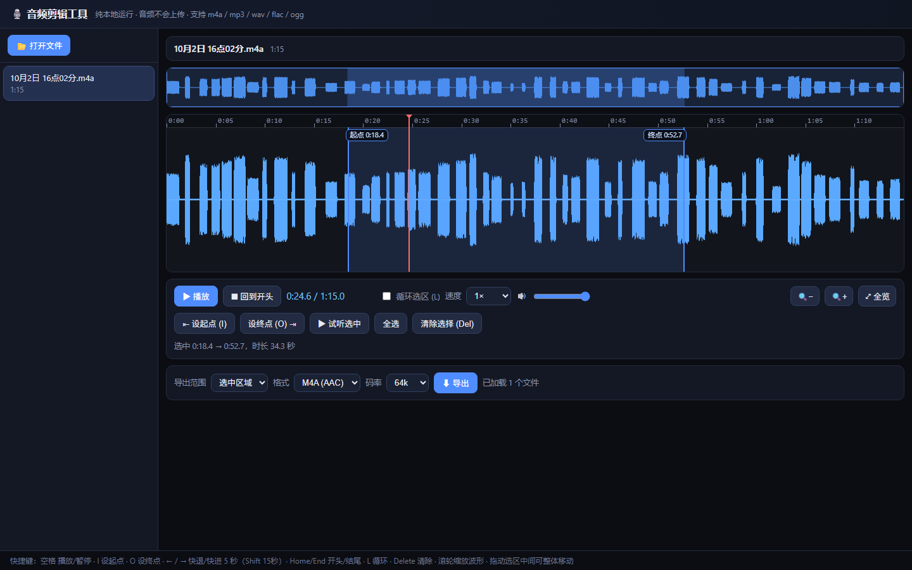
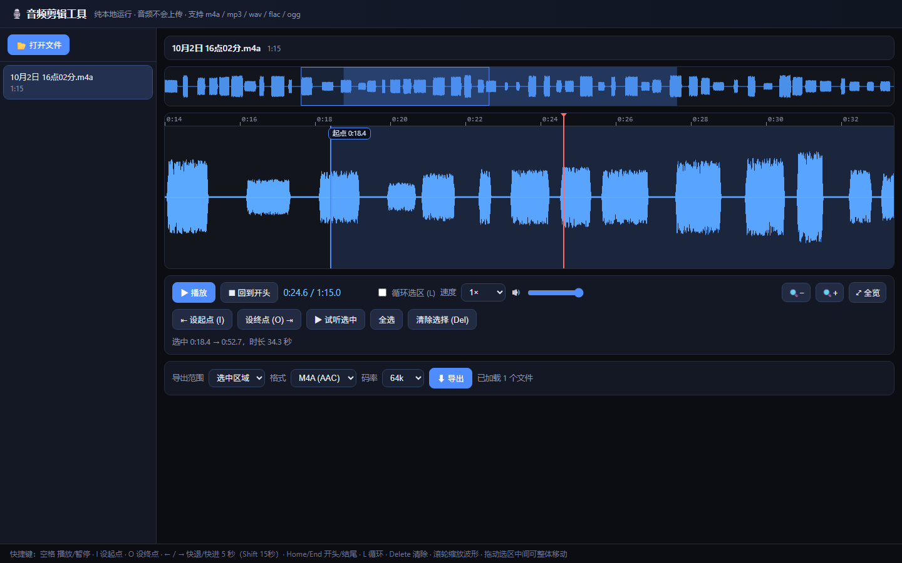

# 🎙️ 音频剪辑工具 (Audio Editing Tool)

> 一个**零安装、纯本地运行**的浏览器音频剪辑工具。专为剪辑微信 / 企业微信录音（`.m4a`）等语音文件设计：
> 播放录音时**拖动快进 / 快退**，**打上起点和终点标记**，然后把保留的片段**导出为 M4A 或 WAV**。



**✅ 无需安装 · ✅ 不上传服务器 · ✅ 单个 HTML 文件 · ✅ Windows / macOS / Linux 通用**

---

## ✨ 功能特性

| 功能 | 说明 |
|---|---|
| 🎧 波形显示 | 自动解码 m4a / mp3 / wav / flac / ogg，绘制高清波形 + 总览图 |
| 🖐 拖动快进快退 | 在波形上按住拖动即可任意定位，上方面板显示精确时间 |
| 🔍 无级缩放 | 滚轮缩放波形（放大到采样级细节），Shift + 滚轮横向滚动 |
| 🚩 起点 / 终点标记 | 按 `I` / `O` 在播放头处打点，或直接拖动蓝色选区边缘微调 |
| ▶ 试听与循环 | 「试听选中」只播放标记片段；勾选「循环选区」反复核对边界 |
| 🐢 变速播放 | 0.5× ~ 2× 变速，找语音里的关键句特别好用 |
| 📁 多文件队列 | 支持同时导入多个文件，每个文件的标记点独立保存 |
| ⬇ 一键导出 | 导出 **M4A (AAC)** 或 **WAV (无损)**，文件名自动带上时间段 |



---

## 🚀 快速开始

**方式一：直接使用（推荐）**

1. 下载本仓库中的 [`audio-cutter.html`](audio-cutter.html)（右键 → 链接另存为）
2. 双击用 **Chrome / Edge** 浏览器打开
3. 把音频文件**拖进窗口**，开始剪辑

**方式二：克隆仓库**

```bash
git clone https://github.com/TMENG888/Audio_editing_tool.git
# 打开目录中的 audio-cutter.html 即可
```

---

## 📖 使用说明

### 第 1 步：导入音频

点击左上角「📂 打开文件」选择音频，或直接把文件**拖拽**到窗口里。
可以一次导入多个文件，左侧列表点击切换；列表中会显示每个文件的时长和标记状态。

### 第 2 步：播放与定位

- 点 **▶ 播放** 或按 **空格键** 播放 / 暂停
- **在波形上按住鼠标左右拖动**，即可快进 / 快退（拖动时自动暂停，松手继续播放）
- 也可以点击上方**总览条**快速跳转，或用 **← / →** 键每次快退 / 快进 5 秒
- 滚轮缩放波形，放大后可以精确定位到 0.1 秒级别
- 语速太快听不清？把「速度」调到 **0.5×** 慢速播放

### 第 3 步：标记保留区间

三种方式任选：

1. **快捷键打点**：播放到想保留的开头按 `I`（设起点），播放到结尾按 `O`（设终点）
2. **拖动手柄**：直接拖动波形上蓝色选区的左右边缘微调，边缘上方显示精确时间
3. **整体移动**：拖动选区中间部分，整个区间一起移动

辅助工具：
- 「▶ 试听选中」：只播放标记的片段，其余跳过
- 「循环选区 (L)」：勾选后片段循环播放，方便反复核对边界
- 「全选」：一键选中整个文件
- 「清除选择 (Del)」：取消标记

### 第 4 步：导出

在底部导出面板中选择：

| 选项 | 说明 |
|---|---|
| 导出范围 | **选中区域**（只导出标记片段）/ **整个文件** |
| 格式 | **M4A (AAC)**：体积小，推荐语音录音；**WAV**：无损 PCM，兼容一切后期软件 |
| 码率 | M4A 专用，语音推荐 64k，音乐建议 128k 以上 |

点「⬇ 导出」后浏览器自动下载，文件名自动携带时间段，例如：

```
10月2日 16点02分_剪辑_18m18s-52m52s.m4a
```

> 💡 **导出小知识**
> - 导出**整个文件**且未做任何剪辑时，选 M4A 会**直接复制原文件**，零损失、瞬间完成
> - 导出**选中的片段**为 M4A 时会重新编码；首次使用需联网自动下载一次编码器（约 30MB，之后有缓存）
> - **WAV 导出完全离线可用**，如果 M4A 编码器加载失败，改用 WAV 一定可以

---

## ⌨️ 快捷键一览

| 快捷键 | 功能 |
|---|---|
| `空格` | 播放 / 暂停 |
| `I` | 在播放头处设起点 |
| `O` | 在播放头处设终点 |
| `←` / `→` | 快退 / 快进 5 秒（`Shift` 15 秒） |
| `Home` / `End` | 跳到文件开头 / 结尾 |
| `L` | 循环选区 开 / 关 |
| `Delete` | 清除选区 |
| `滚轮` | 缩放波形（`Shift` + 滚轮横向滚动） |

---

## ❓ 常见问题

**Q：会上传我的录音吗？**
不会。所有解码、剪辑、编码全部在你浏览器内完成，断网也能用（仅 M4A 片段导出首次需联网下载编码器）。

**Q：支持哪些格式？**
导入：m4a / mp3 / wav / aac / flac / ogg 等浏览器能解码的音频。
导出：M4A (AAC)、WAV。

**Q：M4A 导出提示失败？**
检查网络后重试；或改用 WAV 格式（必定可用），之后再用其他工具转 M4A。

**Q：为什么波形放大后变得更精细？**
工具内置三级峰值数据：粗览用预计算的峰值包络，深度放大时直接读取原始采样点绘制。

**Q：手机上能用吗？**
界面按桌面浏览器设计，手机可用但操作体验一般，推荐电脑使用。

---

## 🛠 技术实现

单个 HTML 文件，无任何构建依赖：

- **Web Audio API**：`decodeAudioData` 解码、`AudioBufferSourceNode` 实现采样级精确 seek 与变速播放
- **Canvas**：两级预计算峰值包络 + 实时重采样绘制，长文件也能流畅缩放
- **ffmpeg.wasm**（按需 CDN 加载）：纯浏览器内完成 AAC 编码导出 M4A
- 纯原生 JavaScript，约 900 行，可直接阅读修改

## 📄 许可证

[MIT](LICENSE) © 2025 TMENG888
